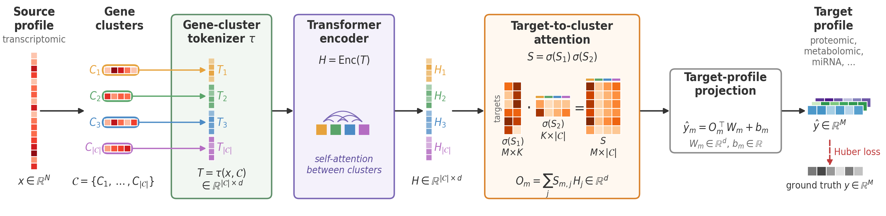

# OmiGlot

OmiGlot is an interpretable transformer-based framework for cross-omic translation: it translates the transcriptome into other omic layers (metabolome, proteome, miRNA), in both bulk and single-cell data.

Since transformers operate on sequences while omics data have no inherent order, OmiGlot first groups co-expressed genes into clusters (Leiden algorithm) and represents each cluster as a token. Self-attention then models interactions between gene clusters rather than individual genes. Each target feature (e.g. a metabolite or a protein) aggregates the cluster representations through a learned low-rank importance matrix, which quantifies the contribution of each gene cluster to each target feature. This matrix provides cross-omic interpretability and can be used for feature selection, by highlighting the most informative gene clusters for each target.



## Getting Started

### Installation
```bash
git clone the repository
cd OmiGlot
pip install -r requirements.txt
```

A step-by-step tutorial is available in [`tutorial.ipynb`](tutorial.ipynb), 
covering data loading, model training, and generation.

## Datasets

| Dataset | Translation | Source |
|---|---|---|
| CCLE | RNA-seq → metabolome | [DepMap Portal](https://depmap.org/portal/) |
| TCGA-BRCA | RNA-seq → protein (RPPA) | [GDC Data Portal](https://portal.gdc.cancer.gov/) |
| TCGA-LUAD | RNA-seq → miRNA | [GDC Data Portal](https://portal.gdc.cancer.gov/) |
| TCGA-LUAD | RNA-seq → protein (RPPA) | [GDC Data Portal](https://portal.gdc.cancer.gov/) |
| CBMC | scRNA-seq → surface protein (ADT) | [GEO: GSE100866](https://www.ncbi.nlm.nih.gov/geo/query/acc.cgi?acc=GSE100866) |

The full datasets are not included in this repository; they can be downloaded from the sources above.